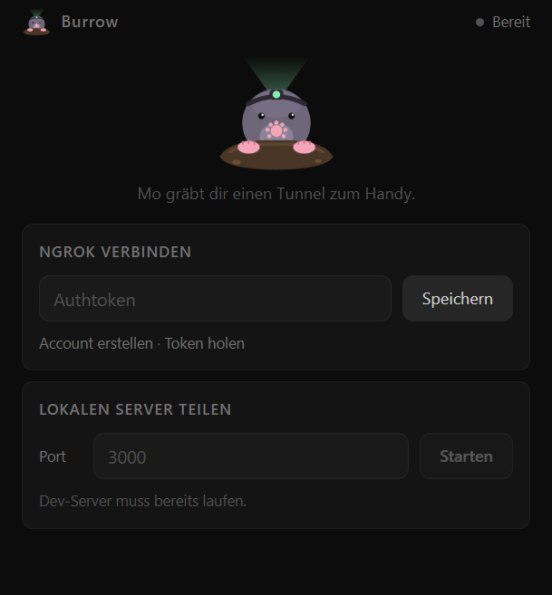
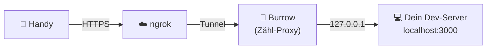

<div align="center">


# Burrow

**Mo der Maulwurf gräbt dir einen Tunnel von deinem Dev-Server aufs Handy.**

Port eintippen · Starten · QR-Code scannen · fertig.

[](https://github.com/FlyingV111/burrow/actions/workflows/ci.yml)
[](LICENSE)
[](https://www.electronjs.org)
[](https://nodejs.org)



</div>

---

## Warum Burrow?

Du entwickelst eine Web-App auf `localhost:3000` und willst sie **kurz auf dem echten Handy testen** – ohne WLAN-Gefrickel, ohne IP-Adressen abtippen, ohne CLI-Befehle zu googeln.

Burrow ist eine winzige Desktop-App, die genau das tut: Sie öffnet per [ngrok](https://ngrok.com) einen sicheren HTTPS-Tunnel zu deinem lokalen Port und zeigt dir den QR-Code dazu.

## Features

|     |                                                                                                                                  |
| --- | -------------------------------------------------------------------------------------------------------------------------------- |
| 📱  | **Ein Klick zum Handy** – öffentliche HTTPS-URL plus QR-Code zum Scannen                                                         |
| 📊  | **Live-Statistik** – Anfragen, Datenmenge und aktive Verbindungen als Sparklines                                                 |
| ⌨️  | **Port-Feld ohne Bevormundung** – tippe, was du willst; geprüft wird erst beim Start, mit klarer Meldung statt stiller Korrektur |
| 🔐  | **Token sicher gespeichert** – verschlüsselt mit dem Schlüsselspeicher deines Betriebssystems                                    |
| 🏠  | **Komplett lokal** – die Oberfläche ist nur über `127.0.0.1` erreichbar                                                          |
| 🪶  | **Klein und ruhig** – ein festes 420×500-Fenster, dunkel, ohne Schnickschnack                                                    |

## So funktioniert es



Zwischen ngrok und deinem Server sitzt ein kleiner Proxy. Er leitet alles unverändert durch (inklusive WebSockets, damit Hot-Reload funktioniert) und zählt nebenbei den Datenverkehr für die Live-Anzeige.

## Installation

**Voraussetzungen:** Node.js 18 oder neuer und ein kostenloser [ngrok-Account](https://dashboard.ngrok.com/signup) mit [Authtoken](https://dashboard.ngrok.com/get-started/your-authtoken).

```bash
git clone https://github.com/FlyingV111/burrow.git
cd burrow
npm install
npm start
```

Eine eigenständige Windows-Datei (portable, ohne Installation) baust du mit:

```bash
npm run build      # Ergebnis: dist/Burrow 1.0.0.exe
```

## Benutzung

1. **Token eintragen** – beim ersten Start einmalig deinen ngrok-Authtoken einfügen und speichern.
2. **Port eingeben** – der Port deines laufenden Dev-Servers (`3000`, `5173`, `8080` …). Der Server muss bereits laufen.
3. **Starten** – Mo gräbt den Tunnel. Scanne den QR-Code oder kopiere die URL.
4. **Beenden** – „Tunnel beenden“ schließt den Zugang sofort wieder.

> [!TIP]
> Ohne Desktop-Fenster geht es auch im Browser: `npm run server` und dann `http://localhost:4040` öffnen. In diesem Modus gibt es keinen Schlüsselspeicher – der Token wird nicht gespeichert. Setze ihn stattdessen als Umgebungsvariable `NGROK_AUTHTOKEN`.

## Sicherheit

Ein Tunnel macht deinen lokalen Server **öffentlich erreichbar**. Burrow versucht, wenigstens den Rest sauber zu halten:

- 🔑 Der Authtoken wird **nie im Klartext** gespeichert (Electron `safeStorage`, unter Windows DPAPI) und von der lokalen API nie zurückgegeben.
- 🔒 Der interne Server lauscht nur auf `127.0.0.1` und lehnt fremde `Host`- und `Origin`-Header ab (Schutz vor DNS-Rebinding und Cross-Site-Requests).
- 🧱 Strikte Content-Security-Policy, kein Inline-Script, serverseitige Validierung aller Eingaben.
- 📦 Electron-Fenster mit Sandbox, `contextIsolation`, ohne Node-Integration und mit blockierter Navigation.

Teile die Tunnel-URL nur mit Leuten, denen du vertraust, und beende den Tunnel, wenn du fertig bist. Details und Meldeweg für Sicherheitslücken: [SECURITY.md](SECURITY.md).

## FAQ

<details>
<summary><b>Wo werden meine Einstellungen gespeichert?</b></summary>

In `~/.burrow/config.json` (unter Windows `C:\Users\<Name>\.burrow`). Der Token steht dort nur verschlüsselt. Einstellungen und Token aus den Vorgängerversionen (`~/.tunnel`, `~/.mitn`) werden beim ersten Start automatisch übernommen, der alte Klartext-Token wird dabei entfernt.

</details>

<details>
<summary><b>„Port muss zwischen 1 und 65535 liegen“ – warum korrigiert Burrow das nicht einfach?</b></summary>

Weil es dich nicht bevormunden soll. Das Feld bleibt, wie du es getippt hast; erst beim Start prüft Burrow die Eingabe und sagt dir, was nicht stimmt.

</details>

<details>
<summary><b>Der Tunnel startet, aber die Seite zeigt „Bad Gateway“.</b></summary>

Dein Dev-Server läuft nicht auf dem angegebenen Port. Starte ihn zuerst und prüfe, ob er unter `http://localhost:<port>` erreichbar ist.

</details>

<details>
<summary><b>Läuft das auch unter macOS oder Linux?</b></summary>

Der Code ist plattformunabhängig, getestet und als Build vorbereitet ist bisher nur Windows. Mit `npm start` solltest du Burrow überall starten können, wo Electron läuft.

</details>

## Entwicklung

```bash
npm run lint          # ESLint
npm run format        # Prettier
npm test              # Tests (node:test)
npm run check         # Lint + Format + Tests, wie in der CI
npm run icons         # App-Icon aus build/icon.svg neu rendern
```

```
electron/main.js      Electron-Hauptprozess (Sandbox, Token-Verschlüsselung)
src/server.js         Express-API: nur Loopback, CSP, Origin-Prüfung
src/tunnel.js         ngrok-Tunnel starten und stoppen
src/proxy.js          Zähl-Proxy für die Traffic-Statistik
src/port.js           Strikte Port-Validierung
src/config.js         Einstellungen und verschlüsselter Token
src/public/           Oberfläche (HTML, CSS, JS, Maskottchen)
test/                 Tests
```

## Lizenz

[MIT](LICENSE) © FlyingV111

<div align="center">
<sub>Gebaut mit Erde unter den Fingernägeln. 🦡</sub>
</div>
